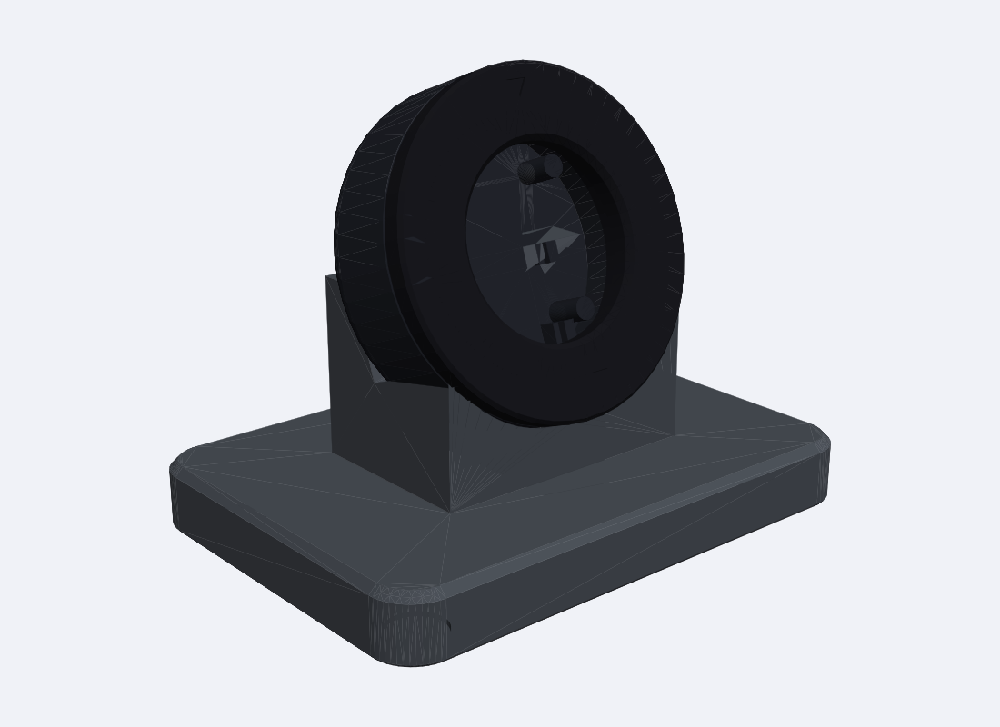

# Simple Desk Case (sturdy version)

A plain round puck with a weighted wedge stand — the same general format as the stock case, just bigger and
chunkier. Same parts: **ESP32-C3 Super Mini + 1.28" GC9A01 + USB-C cable.** No screws, no glue.

| | Stock-style | This |
|---|---|---|
| Puck diameter | ~46–50 mm | **60 mm** |
| Side wall / rear wall / bezel | ~2 mm | **7.5 / 4 / 4 mm** |
| Stand | small | **100 × 72 × 12 mm wedge**, screen leans back 20° |

## Print (PETG or PLA, 0.2 mm layers, 4 walls, no supports)
| STL | Qty | Orientation / notes |
|---|---|---|
| `body.stl` | 1 | rear on the bed |
| `bezel.stl` | 1 | face down |
| `stand.stl` | 1 | flat. 100% infill, or load the underside with steel washers; 4 × Ø10 mm rubber bumpers go in the recesses |
| `plunger.stl`, `cap.stl` | 1 each | BOOT / range button on the back |

## Assemble
1. Solder short wires display → board (pin map in the repo README); solder directly to the display pads.
2. Drop the plunger into the back hole from inside, then press the board in (USB-C end down, buttons facing the back) until the 4 clips click. Press the cap onto the plunger tip.
3. Plug the USB-C cable into the board; the plug exits through the slot at the bottom of the body.
4. Put the display in the bezel (wire notch at the bottom) and push the bezel into the body until it snaps. Pry slot is at the top rim.
5. Thread the cable through the stand's underside groove, and set the puck in the cradle.

## ⚠ Verify first (I couldn't measure your parts)
Assumed in `simple_case.py`: display PCB Ø40 mm, window Ø33.6, board 18 × 22.6 mm, BOOT button position
(`BOOT_X`, `BOOT_Y`), USB-C plug 15 × 8 mm. Check with calipers and edit the numbers, then regenerate:
`python3 simple_case.py`. Checked in CAD: parts are watertight and don't collide; not yet test-printed.
