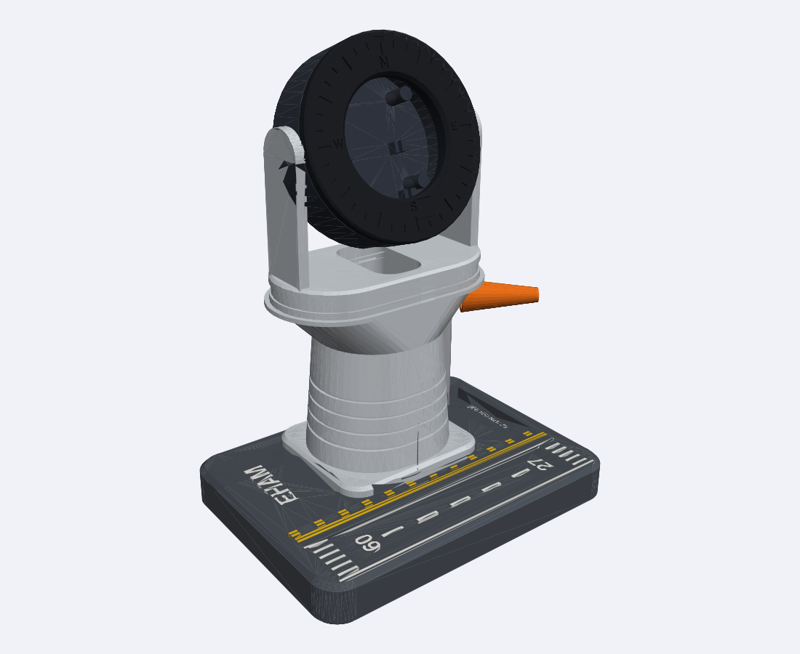
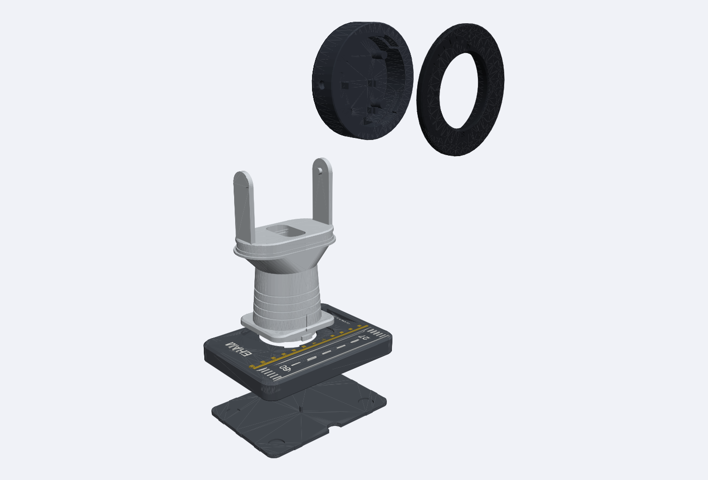

# TOWER SCOPE — desk enclosure for the ESP32 Plane Radar

An air-traffic-control tower that stands on its own airfield. The 1.28" round radar is the tower cab,
tilting on a friction yoke; the base is an apron with a runway whose markings are multi-colour inlays,
your airport's ICAO code, runway designators from your local runway heading, and your coordinates.
A free-spinning windsock sits on the apron.

Same parts as the stock build: **ESP32-C3 Super Mini + 1.28" GC9A01 round display + USB-C data cable.**
No screws, no glue, no extra hardware — bayonet bezel, snap-in board clips, friction pivot, bayonet pedestal.
The firmware in this repo is unchanged.

## Files
| Path | What |
|---|---|
| `tower_scope.py` | Parametric CadQuery source (`pip install cadquery`). `python3 tower_scope.py --icao KJFK --rwy 04 --coords "40.64N 073.78W"` regenerates everything personalised |
| `stl/` | Print-oriented STLs (already laid out for the bed) |
| `tower_scope_assembly.step` | Coloured assembly for CAD / renders |
| `check.py`, `render.py` | Interference checks and preview renderer |

## Parts & print settings
PETG or PLA, 0.2 mm layers, 0.4 mm nozzle, 3 walls. Supports: none needed.

| STL | Qty | Notes |
|---|---|---|
| `head.stl` | 1 | Rear on bed. 100% rigid, 4 walls, 15% infill |
| `bezel.stl` | 1 | Printed face-down. Black. Lugs have a 1.4 mm overhang — fine with part cooling |
| `plunger.stl` | 1 | BOOT-button plunger; 5 mm, print with 0.1 mm layers if you can |
| `cap.stl` | 1 | Beacon-dome button cap, press onto plunger tip |
| `pedestal.stl` | 1 | Upright. Print in PETG — the yoke arms flex ~2.5 mm during assembly |
| `base.stl` | 1 | Printed **top face down** (runway side on bed). Dark grey/black |
| `inlay_white.stl`, `inlay_yellow.stl` | 1 each | 0.8 mm flush inlays. Load together with `base.stl` as one multi-colour object (Bambu/Orca: "load as assembly"), or print the base alone and paint the recesses |
| `plate.stl` | 1 | Bottom plate; press-fit. Load the cavity with ~150 g of steel washers/BBs for weight |
| `pole.stl`, `windsock.stl` | 1 each | Optional accessory. Slide windsock on the pole first, then push the pole into the base socket |
| `fit_test.stl` | 1 | **Print this first** (5 min) — see below |

Rubber feet: 4 × Ø10 mm adhesive bumpers go in the plate recesses.

## ⚠ Verify before printing / selling — I could not measure your parts
I couldn't open the MakerWorld page from my sandbox (network blocked), so nothing here is derived from that
STL — the design is independent. Generic modules vary, so these values in `tower_scope.py` are **assumptions**:

1. **Display PCB diameter** `DISP_D = 40.0`, thickness ≤ 6 mm, 7-pin header at the bottom.
2. **Display window** `WINDOW_D = 33.6` (active area 32.4).
3. **Super Mini outline** 18 × 22.6 mm; **BOOT button position** `BOOT_X, BOOT_Y` (-5, 4.5) — measured from the
   USB-C end; sign convention is in the source. A mirrored board puts it on the other side.
4. **USB-C plug overmould** opening 15 × 8 mm — check against the cable you ship.

`fit_test.stl` has the display pocket ring, the PCB cradle and a BOOT-button hole; drop the real parts in
and adjust. This is the step that decides whether the production design works, so please do it.
Then do a full print and check: bayonet bezel turns ~30° and stops with **N at the top**; yoke snaps onto
the head pins with a slight preload; tilt holds; plug passes through the pedestal bore.

## Assembly
1. Solder short wires display → board (3V3, GND, RST, CS, DC, SDA, SCL per the repo README), pins on the display
   rear are shallow, so solder wires straight to the pads. BOOT stays on the board.
2. Drop the plunger into the head's rear hole from inside (flange inside). Push the board in, USB-C end down,
   until the four clips snap over it. Button side faces the rear.
3. Press the cap onto the plunger tip.
4. Feed the USB-C end of the cable from the rear notch of the base, up through the pedestal bore, plug it into the board.
5. Seat the display in the bezel (wire notch at the bottom), insert bezel with lugs in the entry notches
   and turn clockwise until it stops.
6. Snap the head between the yoke arms. Tilt to taste (default ~20° back).
7. Drop the pedestal into the base (lugs through the three notches), turn to lock, press the plate in.

## Customisation (the marketing hook)
`--icao`, `--rwy`, `--coords` personalise the base. A "Pick your airport" configurator that feeds the repo's
`large_airports_data.cpp` (runway headings!) into this script would make every unit unique.
